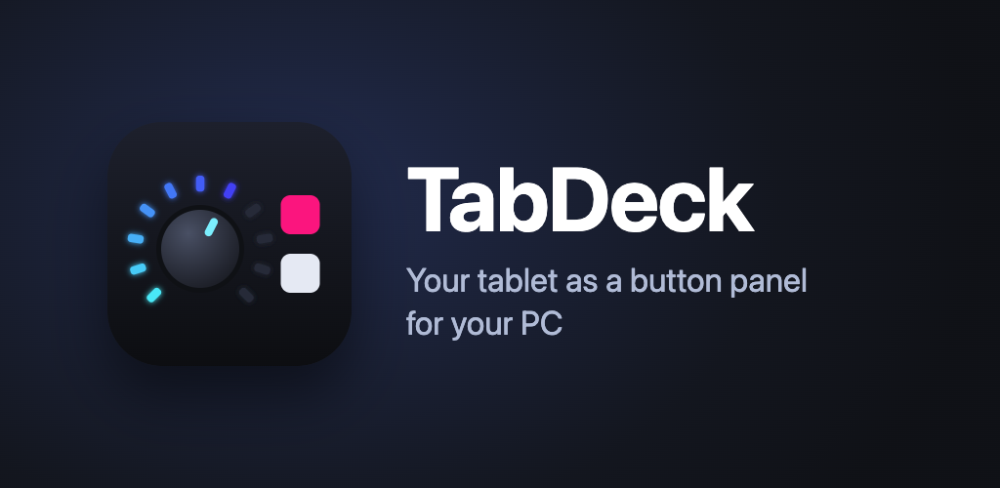
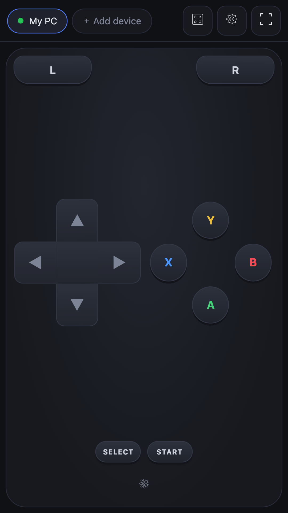

  

  
  
  
  
  

  <b>English</b> · <a href="#한국어">한국어</a>

---

**TabDeck** turns the tablet or phone you already own into a stream-deck-style button panel for your computer.
Install the small desktop app on the computer you want to control, scan its QR code with the tablet, and start tapping.
No account, no cloud — everything stays on your local network.

  

## Download

Get the newest version from **[Releases → Latest](https://github.com/parandol/tabdeck-releases/releases/latest)**.

| | File | Notes |
|---|---|---|
| **Windows** 10/11 (x64) | `TabDeck-<ver>-win-x64.exe` | Installer. A portable `.zip` is also available. |
| **macOS** Apple silicon | `TabDeck-<ver>-mac-arm64.dmg` | M1 and later |
| **macOS** Intel | `TabDeck-<ver>-mac-x64.dmg` | |
| **Linux** Debian / Ubuntu | `TabDeck-<ver>-linux-amd64.deb` | `sudo apt install ./TabDeck-*.deb` |
| **Linux** Fedora / RHEL / openSUSE | `TabDeck-<ver>-linux-x86_64.rpm` | `sudo dnf install ./TabDeck-*.rpm` |
| **Linux** any distro | `TabDeck-<ver>-linux-x86_64.AppImage` | `chmod +x` and run. A `.tar.gz` is also available. |

## Features

- **One tap, any action** — keyboard shortcuts, launching apps and websites, media and volume keys, text snippets, and macros that chain several steps.
- **Buttons that follow your work** — button groups switch automatically to match the app in front, so your editor, browser and video calls each get their own layout.
- **Dials, sliders and folders** — zoom, volume and scroll dials, freely sized buttons, folders up to 8 levels deep.
- **Trackpad and gamepad modes** — use the whole screen as a mouse, or hold arrow and letter keys for games.
- **Many tablets, many computers** — connect several tablets at once and switch between computers from one panel.
- **Private by design** — a connection code protects every computer; nothing leaves your network.
- **9 languages** — English, 한국어, 日本語, 简体中文, 繁體中文, Español, Deutsch, Français, Português.

<table>
  <tr>
    <td width="50%"></td>
    <td width="50%"></td>
  </tr>
  <tr>
    <td align="center">The panel also works in any browser</td>
    <td align="center">Desktop app: connection code, connected tablets, settings</td>
  </tr>
  <tr>
    <td width="50%"></td>
    <td width="50%" align="center"></td>
  </tr>
  <tr>
    <td align="center">Trackpad mode</td>
    <td align="center">Gamepad mode on a phone</td>
  </tr>
</table>

## Getting started

1. Install TabDeck on the computer you want to control and open it. It lives in the tray (menu bar on macOS).
2. On the tablet, scan the QR code shown in the app — or open the address it shows in Chrome / Safari.
3. Tap the **edit (pencil)** button on the panel to add your own buttons.

The tablet and the computer must be on the same Wi-Fi / network.

### First launch notes

- **macOS:** the app is not notarized yet. If macOS says it cannot verify the app, open
  **System Settings → Privacy & Security** and click **Open Anyway**. Then allow TabDeck under
  **Privacy & Security → Accessibility** so it can send shortcuts and move the mouse.
- **Windows:** if SmartScreen appears, click **More info → Run anyway**.
- **Linux (GNOME):** the tray icon may need the *AppIndicator* extension.

## Links

- Blog & privacy policy: <https://parandol.tistory.com/113>
- Report a problem: [Issues](https://github.com/parandol/tabdeck-releases/issues)

---

## 한국어

**TabDeck**은 갖고 있는 태블릿이나 휴대폰을 컴퓨터용 버튼 패널(스트림덱처럼)로 바꿔 주는 앱입니다.
제어할 컴퓨터에 데스크톱 앱을 설치하고, 태블릿으로 QR 코드를 찍으면 바로 쓸 수 있습니다.
계정도 클라우드도 필요 없고, 모든 통신은 같은 네트워크 안에서만 이루어집니다.

### 다운로드

**[Releases → Latest](https://github.com/parandol/tabdeck-releases/releases/latest)** 에서 최신 버전을 받습니다.

| 운영체제 | 파일 |
|---|---|
| 윈도우 10/11 | `TabDeck-<버전>-win-x64.exe` (설치 프로그램), `-win-x64.zip` |
| 맥 Apple 실리콘 / 인텔 | `TabDeck-<버전>-mac-arm64.dmg` / `-mac-x64.dmg` |
| 리눅스 데비안·우분투 | `TabDeck-<버전>-linux-amd64.deb` |
| 리눅스 페도라·RHEL·openSUSE | `TabDeck-<버전>-linux-x86_64.rpm` |
| 리눅스 공통 | `TabDeck-<버전>-linux-x86_64.AppImage`, `-linux-x64.tar.gz` |

### 주요 기능

- **버튼 한 번으로** 단축키, 앱·웹사이트 열기, 미디어·볼륨 조절, 문구 입력, 여러 동작을 잇는 매크로를 실행합니다.
- **지금 쓰는 앱에 맞춰** 버튼 그룹이 자동으로 바뀝니다.
- **다이얼·슬라이더·폴더**: 확대·볼륨·스크롤 다이얼, 크기를 자유롭게 정하는 버튼, 최대 8단계 폴더를 지원합니다.
- **트랙패드·게임패드 모드**: 화면 전체를 마우스로 쓰거나, 방향키·문자키를 누르고 있을 수 있습니다.
- **여러 태블릿, 여러 컴퓨터**: 태블릿 여러 대를 동시에 연결하고, 한 패널에서 컴퓨터를 바꿔 가며 제어합니다.
- **개인정보 보호**: 연결 코드를 아는 기기만 제어할 수 있고, 데이터는 네트워크 밖으로 나가지 않습니다.

### 시작하기

1. 제어할 컴퓨터에 TabDeck을 설치하고 실행합니다. 트레이(맥은 메뉴 막대)에서 실행됩니다.
2. 태블릿으로 앱에 나온 QR 코드를 찍거나, 표시된 주소를 크롬·사파리에서 엽니다.
3. 패널의 **편집(연필)** 버튼을 눌러 원하는 버튼을 추가합니다.

태블릿과 컴퓨터는 같은 Wi-Fi(네트워크)에 있어야 합니다.

- **맥:** 아직 Apple 공증을 받지 않았습니다. "확인할 수 없습니다"가 나오면 **시스템 설정 → 개인정보 보호 및 보안**에서 **그래도 열기**를 누르십시오. 단축키와 마우스 제어를 위해 **손쉬운 사용**에서 TabDeck을 허용해야 합니다.
- **윈도우:** SmartScreen이 나오면 **추가 정보 → 실행**을 누르십시오.
- **리눅스(GNOME):** 트레이 아이콘을 보려면 AppIndicator 확장이 필요할 수 있습니다.

블로그·개인정보 처리방침: <https://parandol.tistory.com/113>
