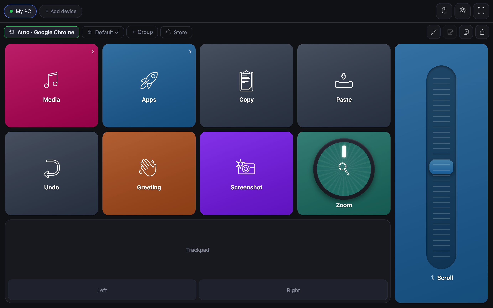
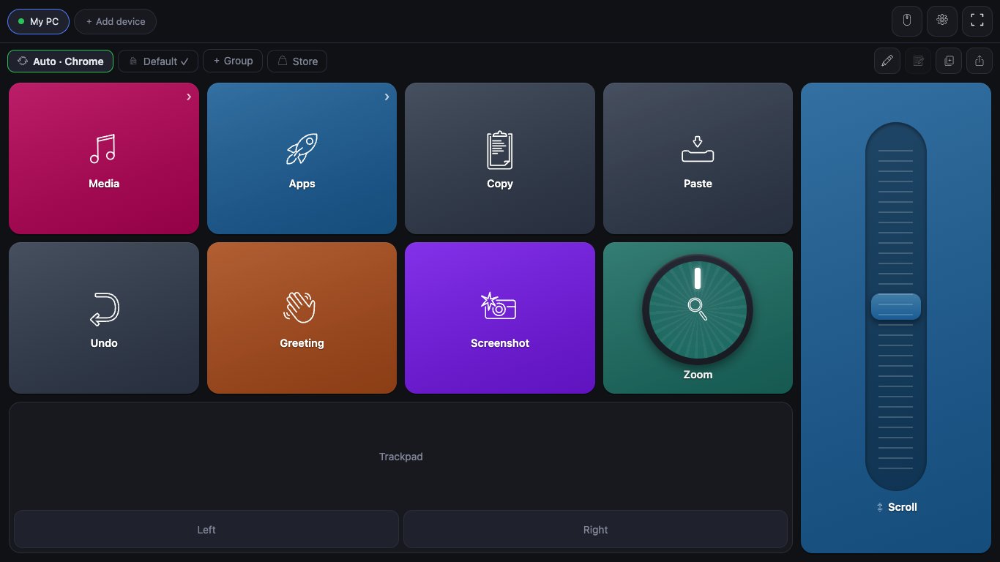
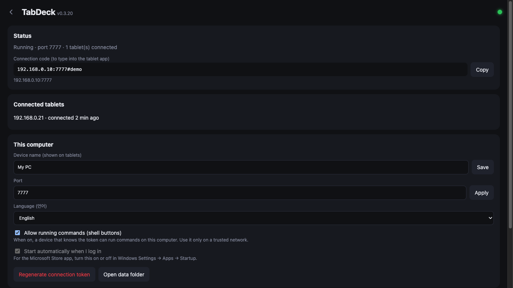
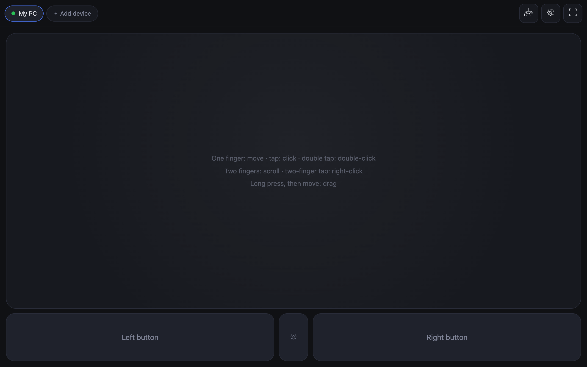

  

  
  
  
  
  

  <b>English</b> · <a href="#한국어">한국어</a>

---

**TabDeck** turns the tablet or phone you already own into a stream-deck-style button panel for your computer.
Install the small desktop app on the computer you want to control, scan its QR code with the tablet, and start tapping.
No account, no cloud — everything stays on your local network.

  

## Download

Get the newest version from **[Releases → Latest](https://github.com/parandol/tabdeck-releases/releases/latest)**.

| | File | Notes |
|---|---|---|
| **Windows** 10/11 (x64) | `TabDeck-<ver>-win-x64.exe` | Installer. A portable `.zip` is also available. |
| **macOS** Apple silicon | `TabDeck-<ver>-mac-arm64.dmg` | M1 and later |
| **macOS** Intel | `TabDeck-<ver>-mac-x64.dmg` | |
| **Linux** Debian / Ubuntu | `TabDeck-<ver>-linux-amd64.deb` | `sudo apt install ./TabDeck-*.deb` |
| **Linux** Fedora / RHEL / openSUSE | `TabDeck-<ver>-linux-x86_64.rpm` | `sudo dnf install ./TabDeck-*.rpm` |
| **Linux** any distro | `TabDeck-<ver>-linux-x86_64.AppImage` | `chmod +x` and run. A `.tar.gz` is also available. |

## Tablet & phone apps

The button panel runs on the tablet or phone you control from.

| | Where | Status |
|---|---|---|
| **Android** | Google Play | Coming soon |
| **iPad / iPhone** | App Store | Coming soon |
| **Any browser** | Open the address (or scan the QR code) shown in the desktop app | Available now |

## Control an Android device from another device

### Over Bluetooth (Google Play app)

Another Android phone or tablet running TabDeck can become this device's Bluetooth keyboard and mouse:

1. On the other device, open TabDeck and tap **Make this device discoverable (2 min)**.
2. On this device, tap **Open Bluetooth settings** and pair with that device.
3. On the other device, tap 🔗 next to this device to connect, then open its panel.

### Full control over the network (direct-install app)

To control the Android device fully — touch, back/home, switching apps — use the
[direct-install app](#android-direct-install). It uses Android's accessibility service, which the Google Play app does not include.

1. Install the direct-install app and turn on TabDeck under **Settings → Accessibility**.
2. Scan the QR code under **Control this device from another device** on its home screen with another tablet or phone.
   A button panel that controls this Android opens in Safari or Chrome. Choose Share → **Add to Home Screen** to use it like an app.
3. If you cannot scan it, enter the connection code under **＋ Add device** in a TabDeck panel.

**What works on the Android device** (port 7777). Except media keys and volume, these need TabDeck turned on in Accessibility.

| Action | | How |
|---|---|---|
| Open apps and web addresses | ✅ | Launches the app |
| Media keys, volume | ✅ | System media keys |
| Back, home, recent apps, notifications, quick settings, screenshot, lock screen | ✅ | Accessibility system actions |
| Scroll, zoom (dials) | ✅ | Swipe and two-finger pinch gestures |
| Text input | ✅ | Types into the focused field |
| Trackpad | ⚠️ | Shows a cursor on screen; a click taps where it points |
| Switch groups by app | ✅ | Detects the app in front |
| Shortcuts (Ctrl+C etc.) | ⚠️ | Android 13 or later, in input fields only |
| Run command (shell) | ❌ | Not allowed by Android |

### Panel guide

- **Editing buttons:** tap ✏️ at the top of the panel. Tap an empty cell (＋) to add a button, dial (knob/bar), trackpad or stick,
  drag items to move them, and use ◢ at the bottom right to resize.
- **Switching button groups by app:** create a group with **＋ Group** and enter an app name (e.g. Procreate).
  The app in front on the Android device is detected automatically when accessibility is on.
  Over Bluetooth the app in front cannot be detected, so on an iPad create a Shortcuts automation:
  Automation → ＋ → App → (choose app) *Is Opened* → Run Immediately → **Get Contents of URL** with
  `http://<Android IP>:7777/api/active-app?target=bluetooth&token=<connection code>&app=Procreate`
  (the app home screen shows the exact address; the app name at the end must match the group's app name).
- **App switching (⌘+Tab):** choose 🔀 *App switch* in a dial's quick settings. While you hold the dial, ⌘ stays pressed and each step
  moves through the apps; release to switch.

### Troubleshooting

- Even if the other device shows *Connected* in its Bluetooth settings, the keyboard connection is separate: tap 🔗 under the Bluetooth devices.
- If it still does not connect, forget this device in the other device's Bluetooth settings and pair again.
- If another device cannot reach the panel, make sure both are on the same Wi-Fi.

## Android direct install

A version of the Android app that is installed directly instead of from Google Play. On top of the
Google Play app it can **control the Android device itself** from another device (touch, back/home,
switching apps — through Android's accessibility service), and it updates itself from this page.

- File: `TabDeck-<ver>-android.apk` on **[Releases → Latest](https://github.com/parandol/tabdeck-releases/releases/latest)** — *in preparation, not uploaded yet.*
- When installing, allow your browser or file manager to **install unknown apps**.
- After installing, turn on TabDeck under **Settings → Accessibility** to let other devices control this one.
- It cannot be installed next to the Google Play version for now; remove one before installing the other.

## Features

- **One tap, any action** — keyboard shortcuts, launching apps and websites, media and volume keys, text snippets, and macros that chain several steps.
- **Buttons that follow your work** — button groups switch automatically to match the app in front, so your editor, browser and video calls each get their own layout.
- **Dials, sliders and folders** — zoom, volume and scroll dials, freely sized buttons, folders up to 8 levels deep.
- **Trackpad and gamepad modes** — use the whole screen as a mouse, or hold arrow and letter keys for games.
- **Many tablets, many computers** — connect several tablets at once and switch between computers from one panel.
- **Private by design** — a connection code protects every computer; nothing leaves your network.
- **9 languages** — English, 한국어, 日本語, 简体中文, 繁體中文, Español, Deutsch, Français, Português.

<table>
  <tr>
    <td width="50%"></td>
    <td width="50%"></td>
  </tr>
  <tr>
    <td align="center">The panel also works in any browser</td>
    <td align="center">Desktop app: connection code, connected tablets, settings</td>
  </tr>
  <tr>
    <td width="50%"></td>
    <td width="50%" align="center"></td>
  </tr>
  <tr>
    <td align="center">Trackpad mode</td>
    <td align="center">Gamepad mode on a phone</td>
  </tr>
</table>

## Getting started

1. Install TabDeck on the computer you want to control and open it. It lives in the tray (menu bar on macOS).
2. On the tablet, scan the QR code shown in the app — or open the address it shows in Chrome / Safari.
3. Tap the **edit (pencil)** button on the panel to add your own buttons.

The tablet and the computer must be on the same Wi-Fi / network.

### First launch notes

- **macOS:** the app is not notarized yet. If macOS says it cannot verify the app, open
  **System Settings → Privacy & Security** and click **Open Anyway**. Then allow TabDeck under
  **Privacy & Security → Accessibility** so it can send shortcuts and move the mouse.
- **Windows:** if SmartScreen appears, click **More info → Run anyway**.
- **Linux (GNOME):** the tray icon may need the *AppIndicator* extension.

## Links

- Privacy policy: <https://ejsoft.kr/privacy_en.html>
- Report a problem: [Issues](https://github.com/parandol/tabdeck-releases/issues)

---

## 한국어

**TabDeck**은 갖고 있는 태블릿이나 휴대폰을 컴퓨터용 버튼 패널(스트림덱처럼)로 바꿔 주는 앱입니다.
제어할 컴퓨터에 데스크톱 앱을 설치하고, 태블릿으로 QR 코드를 찍으면 바로 쓸 수 있습니다.
계정도 클라우드도 필요 없고, 모든 통신은 같은 네트워크 안에서만 이루어집니다.

### 다운로드

**[Releases → Latest](https://github.com/parandol/tabdeck-releases/releases/latest)** 에서 최신 버전을 받습니다.

| 운영체제 | 파일 |
|---|---|
| 윈도우 10/11 | `TabDeck-<버전>-win-x64.exe` (설치 프로그램), `-win-x64.zip` |
| 맥 Apple 실리콘 / 인텔 | `TabDeck-<버전>-mac-arm64.dmg` / `-mac-x64.dmg` |
| 리눅스 데비안·우분투 | `TabDeck-<버전>-linux-amd64.deb` |
| 리눅스 페도라·RHEL·openSUSE | `TabDeck-<버전>-linux-x86_64.rpm` |
| 리눅스 공통 | `TabDeck-<버전>-linux-x86_64.AppImage`, `-linux-x64.tar.gz` |

### 태블릿·휴대폰 앱

버튼 패널은 조작하는 쪽 태블릿이나 휴대폰에서 실행합니다.

| | 받는 곳 | 상태 |
|---|---|---|
| **안드로이드** | Google Play | 준비 중 |
| **아이패드·아이폰** | App Store | 준비 중 |
| **모든 브라우저** | 데스크톱 앱에 나온 주소를 열거나 QR 코드를 찍기 | 지금 사용 가능 |

### 다른 기기에서 안드로이드 제어

#### 블루투스로 (Google Play 앱)

TabDeck을 설치한 다른 안드로이드 휴대폰·태블릿이 이 기기의 블루투스 키보드와 마우스가 됩니다.

1. 다른 기기에서 TabDeck을 열고 **이 기기 찾기 허용 (2분)**을 누릅니다.
2. 이 기기에서 **블루투스 설정 열기**를 눌러 그 기기를 찾아 페어링합니다.
3. 다른 기기의 목록에서 이 기기의 🔗를 눌러 연결한 뒤 패널을 엽니다.

#### 네트워크로 완전히 제어 (직접 설치 앱)

터치, 뒤로·홈, 앱 전환까지 안드로이드를 완전히 제어하려면 [직접 설치 앱](#안드로이드-직접-설치)이 필요합니다.
안드로이드 접근성 서비스를 사용하며, Google Play 앱에는 이 기능이 없습니다.

1. 직접 설치 앱을 설치하고 **설정 → 접근성**에서 TabDeck을 켭니다.
2. 앱 첫 화면의 **다른 기기에서 이 기기 제어** QR 코드를 다른 태블릿·폰에서 스캔합니다.
   Safari나 Chrome에서 이 안드로이드를 제어하는 버튼 패널이 열립니다. 공유 → **홈 화면에 추가**를 선택하면 앱처럼 쓸 수 있습니다.
3. 스캔할 수 없으면 TabDeck 패널의 **＋ 기기 추가**에 연결 코드를 입력하십시오.

**안드로이드에서 지원하는 기능** (포트 7777). 미디어 키와 볼륨을 뺀 나머지는 접근성에서 TabDeck을 켜야 동작합니다.

| 기능 | | 방식 |
|---|---|---|
| 앱 열기, 웹 주소 열기 | ✅ | 앱 실행 |
| 미디어 키, 볼륨 | ✅ | 시스템 미디어 키 |
| 뒤로·홈·최근 앱·알림창·빠른 설정·스크린숏·화면 잠금 | ✅ | 접근성 시스템 동작 |
| 스크롤, 확대·축소(다이얼) | ✅ | 화면 밀기·두 손가락 집기 동작 |
| 텍스트 입력 | ✅ | 입력칸에 글자 넣기 |
| 트랙패드 | ⚠️ | 화면에 커서를 띄우고 누르면 그 자리를 탭 |
| 앱에 따라 그룹 자동 전환 | ✅ | 맨 앞 앱 감지 |
| 단축키(Ctrl+C 등) | ⚠️ | 안드로이드 13 이상, 입력칸에서만 |
| 명령 실행(셸) | ❌ | 안드로이드가 허용하지 않음 |

#### 패널 사용법

- **버튼 편집:** 패널 상단의 ✏️를 누릅니다. 빈칸(＋)을 눌러 버튼·다이얼(노브/바)·트랙패드·스틱을 추가하고, 드래그해 옮기며, 오른쪽 아래 ◢로 크기를 조절합니다.
- **앱에 따라 버튼 그룹 자동 전환:** **＋ 그룹**으로 그룹을 만들고 앱 이름(예: Procreate)을 입력합니다. 안드로이드의 맨 앞 앱은 접근성이 켜져 있으면 자동으로 감지합니다.
  블루투스로는 상대 기기의 앱을 알 수 없으므로, 아이패드에서는 단축어 → 자동화 → ＋ → 앱 → (앱 선택) *열릴 때* → 즉시 실행 → **URL 콘텐츠 가져오기**에
  `http://<안드로이드 IP>:7777/api/active-app?target=bluetooth&token=<연결 코드>&app=Procreate`를 넣으십시오
  (정확한 주소는 앱 첫 화면에 나옵니다. 끝의 앱 이름은 그룹의 앱 이름과 같아야 합니다).
- **앱 전환 (⌘+Tab):** 다이얼의 빠른 설정에서 🔀 *앱 전환*을 고르면, 다이얼을 잡고 있는 동안 ⌘가 눌린 채로 Tab으로 앱을 넘기고, 손을 떼면 그 앱으로 전환됩니다.

#### 문제 해결

- 상대 기기의 블루투스 설정에 *연결됨*으로 나와도 키보드 연결은 따로 해야 합니다. 블루투스 기기 목록에서 🔗를 누르십시오.
- 그래도 연결되지 않으면 상대 기기의 블루투스 설정에서 이 기기를 삭제한 뒤 다시 페어링하십시오.
- 다른 기기에서 패널에 접속되지 않으면 두 기기가 같은 Wi-Fi에 있는지 확인하십시오.

### 안드로이드 직접 설치

Google Play 대신 직접 설치하는 안드로이드 앱입니다. Google Play 앱의 기능에 더해 **다른 기기에서 이 안드로이드
자체를 제어**(터치, 뒤로·홈, 앱 전환 — 안드로이드 접근성 서비스 사용)할 수 있고, 이 페이지에서 스스로 업데이트합니다.

- 파일: **[Releases → Latest](https://github.com/parandol/tabdeck-releases/releases/latest)** 의 `TabDeck-<버전>-android.apk` — *준비 중이며 아직 올라가지 않았습니다.*
- 설치할 때 브라우저나 파일 관리자의 **출처를 알 수 없는 앱 설치**를 허용하십시오.
- 설치한 뒤 **설정 → 접근성**에서 TabDeck을 켜야 다른 기기에서 이 기기를 제어할 수 있습니다.
- 지금은 Google Play 버전과 함께 설치할 수 없습니다. 하나를 지운 뒤 설치하십시오.

### 주요 기능

- **버튼 한 번으로** 단축키, 앱·웹사이트 열기, 미디어·볼륨 조절, 문구 입력, 여러 동작을 잇는 매크로를 실행합니다.
- **지금 쓰는 앱에 맞춰** 버튼 그룹이 자동으로 바뀝니다.
- **다이얼·슬라이더·폴더**: 확대·볼륨·스크롤 다이얼, 크기를 자유롭게 정하는 버튼, 최대 8단계 폴더를 지원합니다.
- **트랙패드·게임패드 모드**: 화면 전체를 마우스로 쓰거나, 방향키·문자키를 누르고 있을 수 있습니다.
- **여러 태블릿, 여러 컴퓨터**: 태블릿 여러 대를 동시에 연결하고, 한 패널에서 컴퓨터를 바꿔 가며 제어합니다.
- **개인정보 보호**: 연결 코드를 아는 기기만 제어할 수 있고, 데이터는 네트워크 밖으로 나가지 않습니다.

### 시작하기

1. 제어할 컴퓨터에 TabDeck을 설치하고 실행합니다. 트레이(맥은 메뉴 막대)에서 실행됩니다.
2. 태블릿으로 앱에 나온 QR 코드를 찍거나, 표시된 주소를 크롬·사파리에서 엽니다.
3. 패널의 **편집(연필)** 버튼을 눌러 원하는 버튼을 추가합니다.

태블릿과 컴퓨터는 같은 Wi-Fi(네트워크)에 있어야 합니다.

- **맥:** 아직 Apple 공증을 받지 않았습니다. "확인할 수 없습니다"가 나오면 **시스템 설정 → 개인정보 보호 및 보안**에서 **그래도 열기**를 누르십시오. 단축키와 마우스 제어를 위해 **손쉬운 사용**에서 TabDeck을 허용해야 합니다.
- **윈도우:** SmartScreen이 나오면 **추가 정보 → 실행**을 누르십시오.
- **리눅스(GNOME):** 트레이 아이콘을 보려면 AppIndicator 확장이 필요할 수 있습니다.

개인정보처리방침: <https://ejsoft.kr/privacy.html>
